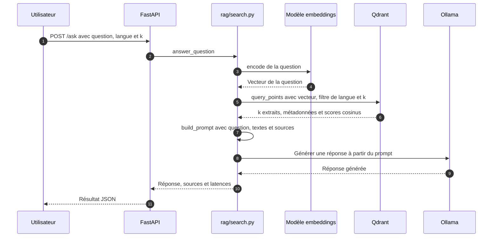

# Noria

**Faites circuler la connaissance.**

Laboratoire de recherche documentaire local avec Ollama, Qdrant et FastAPI.

Ce projet permet de poser des questions à une base de documents locaux. Il utilise le principe du **RAG** (*Retrieval-Augmented Generation*) : retrouver les extraits proches de la question, puis les transmettre à un modèle de langage pour produire une réponse appuyée sur ces documents.

Les documents sont indexés dans **Qdrant**, les vecteurs sont calculés avec **Sentence Transformers** et la réponse est générée par **Ollama**. Une API **FastAPI** expose le service. Les traitements s’exécutent localement ; l’installation initiale nécessite de télécharger les dépendances, les images Docker et les modèles.

## Fonctionnement

### 1. Préparation et indexation

Le script d’ingestion parcourt les fichiers `.txt` et `.md` en UTF-8 ainsi que les PDF contenant du texte dans `data/raw/`, y compris les sous-dossiers. Il les découpe en extraits de **300 caractères**, avec un chevauchement de **60 caractères**, puis écrit `data/chunks.parquet`.

Chaque extrait contient le texte, le chemin relatif du document (`doc_id`), son numéro d’extrait, sa langue, le chemin source et le numéro de page pour les PDF. Le découpage des PDF est effectué page par page pour préserver les références. L’indexation transforme ces textes en vecteurs avec `intfloat/multilingual-e5-base`, puis enregistre les vecteurs et leurs métadonnées dans Qdrant. Le modèle peut être changé depuis l’interface en relançant la pipeline. La recherche utilise la similarité cosinus.

```mermaid
flowchart LR
  docs["Documents .txt, .md et .pdf"]
  ingest["rag/ingest.py &#58; découpage"]
  parquet["data/chunks.parquet"]
  embed["rag/index.py &#58; embeddings"]
  qdrant["Qdrant &#58; vecteurs et métadonnées"]
  docs --> ingest
  ingest --> parquet
  parquet --> embed
  embed --> qdrant
```



**Attention : chaque exécution de `python -m rag.index` recrée la collection Qdrant et remplace donc son contenu existant.**

### 2. Réponse à une question

La question est transformée en vecteur avec le même modèle. Qdrant renvoie les **3 extraits les plus proches**, toutes langues confondues par défaut (filtre optionnel). Le programme construit un prompt contenant ces extraits et demande à Ollama une réponse de 5 à 7 phrases maximum, avec des sources entre crochets. Ces consignes restent des instructions au modèle, sans validation automatique du résultat.



L’API renvoie la réponse, les chemins des sources, les scores de similarité et les temps de recherche et de génération.

### 3. Comment un texte devient un embedding

Un **embedding** est une liste de nombres qui représente le contenu d’un texte pour permettre sa comparaison avec d’autres textes. Dans Noria, `SentenceTransformer.encode(...)` applique le modèle préentraîné `intfloat/multilingual-e5-base` aux extraits pendant l’indexation et à la question pendant la recherche. Le modèle est déjà entraîné : importer un document ne le réentraîne pas.

```mermaid
flowchart TB
  text["1. Texte d’un extrait &#58; La garantie dure 24 mois."]
  encode["2. SentenceTransformer.encode reçoit le texte"]
  tokens["3. Le tokenizer transforme le texte en tokens puis en identifiants numériques"]
  model["4. Le réseau préentraîné calcule des représentations tenant compte du contexte"]
  aggregate["5. Une agrégation produit un vecteur pour le texte entier"]
  vector["6. Embedding &#58; liste de nombres, par exemple 0.023, -0.148, 0.091, ..."]
  text --> encode
  encode --> tokens
  tokens --> model
  model --> aggregate
  aggregate --> vector
```



Les nombres ci-dessus sont fictifs et abrégés. Une coordonnée n’a pas ici une signification lisible comme « durée » ou « garantie » : c’est l’ensemble du vecteur qui sert à comparer les textes. Une question formulée différemment, comme « Pendant combien de temps suis-je couvert ? », peut ainsi être rapprochée de l’extrait sur la garantie. La pertinence dépend du modèle et du corpus.

### 4. Ce qui est stocké dans Qdrant

`rag/index.py` associe chaque extrait à son vecteur et écrit un **point** dans la collection `docs`. Une collection regroupe les points ; l’index vectoriel aide Qdrant à retrouver leurs voisins par similarité cosinus. Les métadonnées attachées à un point sont appelées **payload**.

```mermaid
flowchart TB
  parquet["1. Lire un extrait dans data/chunks.parquet"]
  encode["2. Calculer son embedding avec encode"]
  id["Identifiant UUID dérivé de doc_id et chunk_index"]
  vector["Vecteur &#58; embedding de cet extrait"]
  payload["Payload &#58; text, doc_id, chunk_index, page, lang et source"]
  point["3. Assembler un point &#58; id + vector + payload"]
  collection["4. upsert dans la collection docs de Qdrant"]
  index["5. Qdrant organise les vecteurs pour la recherche de voisins"]
  parquet --> encode
  parquet --> id
  parquet --> payload
  encode --> vector
  id --> point
  vector --> point
  payload --> point
  point --> collection
  collection --> index
```



Exemple illustratif d’un point, avec un vecteur abrégé :

```json
{
  "id": "1cb51e1e-6b59-5b4c-b511-51e222266ef7",
  "vector": [0.023, -0.148, 0.091],
  "payload": {
    "text": "La garantie dure 24 mois.",
    "doc_id": "uploads/abc/contrat.pdf",
    "chunk_index": 0,
    "page": 3,
    "lang": "fr",
    "source": "data/raw/uploads/abc/contrat.pdf"
  }
}
```

`doc_id` identifie le document relativement à `data/raw/`. `source` conserve le chemin utilisé à l’ingestion pour afficher et citer l’origine du passage. `chunk_index` commence à 0 ; `page` commence à 1 pour un PDF et vaut `null` pour un texte. Le PDF original reste sur disque. `data/chunks.parquet` conserve les extraits et leurs métadonnées ; les vecteurs sont calculés ensuite et envoyés à Qdrant.

### 5. Comment la recherche retrouve les extraits (retrieve)

La recherche calcule uniquement l’embedding de la **nouvelle question**. Les vecteurs des extraits sont déjà stockés dans Qdrant. La question et les extraits doivent utiliser le même modèle pour que leurs vecteurs soient comparables.

```mermaid
flowchart TB
  question["1. Question &#58; Combien de temps dure la garantie ?"]
  encode["2. Même modèle embeddings &#58; encode de la question"]
  query["3. query_points &#58; vecteur de la question + langue + k"]
  stored["Vecteurs des extraits déjà stockés dans Qdrant"]
  compare["4. Qdrant recherche les voisins par similarité cosinus parmi les points admissibles"]
  hits["5. Retour des k meilleurs points disponibles avec leur payload et leur score"]
  result["6. retrieve renvoie textes, références, scores et temps de recherche"]
  only["POST /retrieve &#58; afficher les extraits sans génération"]
  prompt["POST /ask &#58; ajouter les textes et les sources au prompt Ollama"]
  question --> encode
  encode --> query
  query --> compare
  stored --> compare
  compare --> hits
  hits --> result
  result --> only
  result --> prompt
```



Par défaut, `k=3`. Le filtre de langue porte sur `payload.lang` ; une langue vide désactive ce filtre. Le score est calculé au moment de la recherche entre la question et chaque résultat : il n’est pas une propriété fixe stockée avec l’extrait. Ollama reçoit ensuite les **textes retrouvés**, leurs sources et la question pour rédiger une réponse. Si aucun extrait n’est trouvé, Noria renvoie un message explicatif sans appeler Ollama.

## Compromis techniques (trade-offs)

| Choix | Avantage | Compromis / limite |
| --- | --- | --- |
| Ollama et embeddings locaux | Maîtrise des documents, pas d’API payante de génération | RAM et stockage nécessaires ; latence et qualité dépendantes du matériel et du modèle |
| Découpage de taille fixe, en caractères | Simple à comprendre et à régler | Peut couper une phrase et séparer des informations liées |
| Chevauchement entre extraits | Préserve une partie du contexte | Augmente le volume et peut retourner des passages redondants |
| Recherche vectorielle seule | Retrouve des formulations proches par le sens | Moins adaptée aux références exactes ; pas de recherche lexicale hybride ni de reclassement |
| Nombre d’extraits limité (3 par défaut) | Contexte court, génération moins coûteuse | Peut manquer des informations ; augmenter le nombre ajoute aussi du bruit |
| Pourcentage dérivé du cosinus | Facilite la comparaison visuelle des résultats | Indice non calibré : 85 % ne signifie pas 85 % de chances d’avoir la bonne réponse |
| Reconstruction complète de l’index | Pipeline simple et reproductible | Recalcule tout le corpus et remplace la collection ; une erreur pendant l’écriture peut laisser un index partiel |
| Sources incluses dans le prompt | Permet de vérifier les affirmations | Les citations générées ne sont pas vérifiées automatiquement |
| Interface sans framework ni compilation | Démarrage avec FastAPI, aucune dépendance Node à installer | Interface prévue pour un laboratoire local, sans comptes utilisateurs ni déploiement multi-utilisateur |
| Tâche en arrière-plan dans le processus API | Suit la pipeline sans infrastructure supplémentaire | État non persistant ; un arrêt ou rechargement du serveur interrompt la tâche. Utiliser une seule instance Uvicorn |

Le service évite désormais d’appeler Ollama lorsqu’aucun extrait ne correspond au filtre. Il ne possède toutefois **aucun seuil minimal de similarité** : des passages peu pertinents peuvent encore être transmis au modèle. Tester une question absente du corpus aide à repérer cette limite.

## Interface graphique : importer, indexer, rechercher

Après le démarrage de Qdrant, d’Ollama et de FastAPI décrit ci-dessous, ouvrir **[Noria](http://localhost:8000)**. L’interface est servie par FastAPI ; aucune compilation frontend n’est nécessaire.

1. **Corpus & pipeline** : importer un ou plusieurs fichiers `.pdf`, `.txt` ou `.md` (textes en UTF-8), par glisser-déposer ou sélection (5 Mo maximum par fichier). Ils sont stockés dans `data/raw/uploads/`, dans des sous-dossiers uniques pour éviter les écrasements, et exclus de Git.
2. Choisir le modèle d’embeddings, la taille des extraits, le chevauchement et l’étiquette du corpus (Multilingue par défaut), puis cliquer sur **Lancer la pipeline**. Elle découpe et réindexe tous les documents de `data/raw/`, y compris le document d’exemple. La progression indique les étapes, pas une estimation du temps restant.
3. Attendre « Corpus prêt pour la recherche », puis ouvrir le **Laboratoire**. Le premier téléchargement et chargement du modèle d’embeddings peut prendre plusieurs minutes.
4. Saisir une question ou clé de recherche. Sélectionner **Recherche seule** pour examiner les extraits sans Ollama, ou **Recherche + réponse** pour tester aussi la génération. Conserver « Toutes les langues » pour rechercher en français dans un PDF anglais ; ajuster le nombre d’extraits (1 à 10). Les filtres FR et EN restreignent les documents selon leur étiquette.
5. Examiner les passages, les scores et les latences. L’interface conserve les 20 derniers tests dans le stockage local du navigateur et permet d’exporter un test complet en JSON. « Effacer » supprime cet historique local.

### Rechercher en français dans un PDF anglais et changer de modèle

Dans **Corpus & pipeline**, choisir **Multilingue** et un modèle d’embeddings, importer le PDF anglais et lancer la pipeline. Dans le **Laboratoire**, conserver **Toutes les langues** et poser la question en français. Les passages restent affichés dans leur langue originale ; le mode **Recherche + réponse** demande à Ollama une réponse dans la langue de la question.

Le même modèle multilingue traite les documents anglais et les questions françaises. Il place leurs vecteurs dans un espace commun où ils peuvent être comparés par le sens. Noria ne change donc pas automatiquement de modèle selon la langue du PDF : le modèle choisi s’applique à tout le corpus et aux recherches qui suivent.

Pour utiliser cette fonctionnalité sur une installation existante :

1. Recharger la page de Noria pour afficher les nouveaux réglages.
2. Dans **Corpus & pipeline**, choisir le **Modèle d’embeddings** et l’étiquette **Multilingue**.
3. Cliquer sur **Lancer la pipeline** et attendre « Corpus prêt pour la recherche ». Cette étape recalcule les vecteurs de tous les documents.
4. Dans le **Laboratoire**, garder **Documents → Toutes les langues**, puis saisir une question en français, même si le PDF est en anglais.

Exemple : un PDF contient « The Boreal warranty lasts 24 months. ». La question « Combien de temps dure la garantie du produit Boreal ? » peut retrouver ce passage sans traduction préalable du document. Les filtres **FR uniquement** et **EN uniquement** limitent les résultats aux étiquettes choisies à l’indexation ; conserver **Toutes les langues** pour rechercher dans un corpus mixte.

Deux modèles sont proposés :

| Modèle | Usage |
| --- | --- |
| `intfloat/multilingual-e5-base` | Modèle multilingue par défaut, commun aux passages et aux questions |
| `sentence-transformers/paraphrase-multilingual-MiniLM-L12-v2` | Alternative multilingue plus légère |

Le modèle configuré via `EMBEDDINGS_MODEL` est aussi proposé s’il est différent. Le premier usage d’un modèle nécessite son téléchargement. Choisir un modèle dans le menu ne change pas immédiatement la recherche : **relancer la pipeline** applique ce choix à tout le corpus. Si le téléchargement ou le calcul échoue avant l’écriture, l’ancien index reste disponible. Pendant l’écriture, la collection existante est remplacée comme auparavant.

Pour E5, Noria préfixe les questions par `query: ` et les extraits par `passage: `, puis normalise les vecteurs, conformément à la [fiche du modèle E5](https://huggingface.co/intfloat/multilingual-e5-base). L’alternative [MiniLM multilingue](https://huggingface.co/sentence-transformers/paraphrase-multilingual-MiniLM-L12-v2) n’utilise pas ces préfixes.

Les nouveaux points Qdrant contiennent aussi `embedding_model` et `embedding_profile` dans leur payload. Pour les anciens index sans ces champs, Noria conserve l’encodage historique et suppose le modèle configuré dans `EMBEDDINGS_MODEL`. L’interface indique de relancer la pipeline pour appliquer le nouveau profil ; il faut le faire une fois pour bénéficier des préfixes E5.

Après une indexation réussie, la recherche reprend le modèle enregistré dans Qdrant, même après un redémarrage du serveur. Le modèle actif apparaît sous le sélecteur de modèles. Pour en changer à nouveau, sélectionner l’autre modèle et relancer la pipeline.

### Comment lire le pourcentage de correspondance ?

Chaque extrait possède un score de similarité cosinus entre le vecteur de la question et celui du texte. Le pourcentage affiché suit la formule :

```text
correspondance (%) = max(0, min(1, score_cosinus)) × 100
Exemple : score 0,856 → correspondance 85,6 %
```

C’est une **proximité sémantique**, pas une proportion de mots identiques, une probabilité de vérité ou un score de qualité de la réponse. Les scores négatifs sont affichés à 0 %. Le score brut et le texte complet de chaque extrait restent visibles pour l’analyse.

### Scénario de test sur vos propres données

Créer un fichier `test-produit.txt` contenant, par exemple :

```text
Le produit Boréal possède une autonomie de 18 heures. Il se recharge en USB-C.
La garantie du produit Boréal dure 24 mois.
```

Importer le fichier, lancer la pipeline, puis rechercher « Quelle est l’autonomie du produit Boréal ? ». Vérifier que le passage retourné contient « 18 heures ». Passer ensuite en mode génération et vérifier que la réponse conserve cette valeur et cite la source. Essayer aussi une question absente du document, puis comparer les résultats avec des tailles d’extraits ou des valeurs de nombre d’extraits différentes.

## Organisation du dépôt

```text
.
├── app/
│   ├── main.py          # API, import de documents et interface à la racine /
│   ├── pipeline.py      # Orchestration et suivi de l’indexation en arrière-plan
│   └── static/          # Interface HTML, CSS et JavaScript sans compilation
├── rag/
│   ├── documents.py     # Extraction du texte brut, Markdown et PDF par page
│   ├── ingest.py        # Lecture et découpage des documents
│   ├── index.py         # Calcul des vecteurs et chargement dans Qdrant
│   ├── search.py        # Recherche, construction du prompt et appel Ollama
│   └── utils.py         # Chargement de la configuration depuis .env
├── data/
│   ├── raw/             # Documents sources ; un README Apache Airflow est fourni
│   └── chunks.parquet   # Extraits générés, à régénérer après modification du corpus
├── test/
│   ├── test_ui_api.py   # Tests hors ligne de l’import, de la pipeline et de l’API
│   └── test_eval.py     # Test de recherche documentaire sur le corpus Airflow
├── docker-compose.yml  # Services Qdrant et Ollama, réseau et volumes persistants
├── pyproject.toml      # Dépendances et configuration des outils Python
├── poetry.lock         # Versions verrouillées des dépendances, à commiter
├── makefile            # Raccourcis : setup, ingest, index, serve, test, eval
└── .env.sample         # Exemple de configuration, à commiter sans secrets
```

## Nom du projet et dossier local

Le projet et son dossier s’appellent **`noria`**. Sur cette machine :

```bash
cd /Users/popylamerveille/Documents/projets/PycharmProjects/noria
make serve
```

Docker Compose utilise le nom de projet explicite `noria`, avec les volumes `noria_qdrant_storage` et `noria_ollama_models`. Les données et les modèles existants ont été copiés dans ces volumes lors du renommage. Les volumes précédents sont conservés comme sauvegarde de migration.

## Installation et démarrage

Exécuter les commandes depuis la racine du dépôt. Prévoir Python **3.10 à 3.12**, Poetry et Docker avec Docker Compose. Le modèle Ollama et le modèle d’embeddings nécessitent de la mémoire et de l’espace disque ; le temps de génération dépend du matériel.

### 1. Installer les dépendances et configurer l’environnement

La cible `setup` sélectionne explicitement Python 3.12 avant d’installer les dépendances verrouillées. Elle évite ainsi de dépendre d’un shim pyenv éventuellement indisponible.

```bash
make setup
cp .env.sample .env
```

Conserver votre `.env` s’il est déjà configuré. Pour sélectionner un autre interpréteur compatible, utiliser par exemple `make setup PYTHON=/opt/homebrew/bin/python3.12` ou `make setup PYTHON=python3.11`. L’option `--no-root` installe les dépendances sans tenter de construire le dépôt comme paquet Python.

Les valeurs suivantes proviennent de `.env.sample` :

| Variable | Valeur d’exemple | Rôle |
| --- | --- | --- |
| `OLLAMA_BASE_URL` | `http://localhost:11434` | Adresse du serveur Ollama |
| `OLLAMA_MODEL` | `llama3.1:8b` | Modèle à charger dans Ollama |
| `QDRANT_HOST` | `localhost` | Hôte Qdrant |
| `QDRANT_PORT` | `6333` | Port HTTP Qdrant |
| `QDRANT_COLLECTION` | `docs` | Collection des extraits |
| `EMBEDDINGS_MODEL` | `intfloat/multilingual-e5-base` | Modèle de représentation vectorielle |
| `CHUNK_SIZE` | `300` | Valeur chargée dans `utils.py`, non utilisée par le script d’ingestion |
| `CHUNK_OVERLAP` | `60` | Valeur chargée dans `utils.py`, non utilisée par le script d’ingestion |
| `LANG_FILTER` | vide | Aucun filtre par défaut ; `fr` ou `en` pour restreindre les documents côté API |

Pour modifier le découpage, utiliser les options `--chunk-size` et `--overlap` du script d’ingestion.

### 2. Démarrer Qdrant et Ollama

```bash
docker compose up -d
docker compose exec ollama ollama pull llama3.1:8b
```

Le nom du modèle téléchargé doit correspondre à `OLLAMA_MODEL` dans `.env`. Attendre que les deux services répondent avant de poursuivre :

```bash
curl http://localhost:6333/readyz
curl http://localhost:11434/api/tags
```

Docker Compose lance uniquement Qdrant et Ollama. Les scripts et l’API Python s’exécutent sur la machine hôte. Les données Qdrant et les modèles Ollama persistent dans des volumes Docker nommés.

### 3. Préparer et indexer les documents

Placer les documents dans `data/raw/`, puis lancer :

```bash
poetry run python -m rag.ingest --path data/raw --chunk-size 300 --overlap 60
poetry run python -m rag.index
```

L’ingestion accepte les fichiers `.txt`, `.md` et `.pdf` contenant du texte extractible. Elle attribue **`lang="multi"` par défaut** à tous les extraits ; utiliser `--lang fr` ou `--lang en` en ligne de commande, ou le sélecteur de l’interface, pour restreindre cette étiquette. La langue n’est pas détectée automatiquement ; la recherche multilingue fonctionne sans cette détection. Les PDF sont lus avec `pypdf`. Les documents chiffrés, illisibles ou sans texte sont refusés avec un message explicite. Les PDF scannés nécessitent un OCR préalable ; les images ne sont pas analysées et les pages sans texte sont ignorées dans un PDF mixte. Le modèle d’embeddings est téléchargé au premier chargement.

### 4. Lancer l’API

```bash
poetry run uvicorn app.main:app --host 127.0.0.1 --port 8000 --reload
```

L’interface graphique est accessible sur **[http://localhost:8000](http://localhost:8000)**. La documentation interactive est accessible sur [Swagger UI](http://localhost:8000/docs).

L’appel à Ollama attend jusqu’à **300 secondes** sans réponse. Sur CPU, le premier chargement du modèle et la génération peuvent dépasser une minute. Pour adapter ce délai, définir `OLLAMA_TIMEOUT_SECONDS=600` dans `.env`, puis redémarrer FastAPI. La connexion au service reste limitée à 5 secondes.

## Utiliser l’API

| Méthode | Route | Description |
| --- | --- | --- |
| `GET` | `/` | Interface Noria |
| `GET` | `/documents` | Liste les documents du corpus local |
| `POST` | `/documents?filename=nom.txt` | Importe un PDF ou un texte UTF-8 envoyé comme corps binaire |
| `POST` | `/pipeline` | Lance l’ingestion et l’indexation en arrière-plan |
| `GET` | `/pipeline` | État et progression de la pipeline |
| `GET` | `/status` | Diagnostic Qdrant, collection et modèle Ollama ; ne charge pas les embeddings |
| `POST` | `/retrieve` | Retourne les extraits sans génération |
| `GET` | `/healthz` | Renvoie `{"status":"ok"}` ; ne vérifie pas Qdrant ni Ollama |
| `POST` | `/ask` | Recherche des extraits et génère une réponse |
| `GET` | `/metrics` | Renvoie des valeurs provisoires, sans collecte réelle de métriques |

Exemple de question sur le document fourni :

```bash
curl -X POST http://localhost:8000/ask \
  -H 'Content-Type: application/json' \
  -d '{"question":"Qu’est-ce qu’un DAG dans Apache Airflow ?","lang":"fr"}'
```

**Pour une recherche multilingue, utiliser `lang: ""`.** Si `lang` est absent, l’API utilise `LANG_FILTER` (vide par défaut). Un filtre explicite `fr` ou `en` ne retourne que les extraits portant cette étiquette ; il exclut ceux étiquetés `multi`. Le paramètre filtre les documents ; le prompt demande à Ollama de répondre dans la langue de la question, même si les sources sont dans une autre langue. Le champ optionnel `k` règle le nombre d’extraits entre 1 et 10 (3 par défaut).

Structure de réponse indicative, avec texte et chiffres d’illustration :

```json
{
  "answer": "Réponse générée à partir du contexte [data/raw/readme.md].",
  "sources": [
    {"source": "data/raw/readme.md", "doc_id": "readme.md", "text": "Extrait retrouvé…", "page": null, "score": 0.85, "correspondence_pct": 85.0}
  ],
  "retrieval_latency_ms": 120,
  "llm_latency_ms": 2400,
  "total_latency_ms": 2525
}
```

Les scores représentent une similarité vectorielle, pas une probabilité que la réponse soit correcte. Lorsqu’aucun extrait n’est trouvé, la génération est ignorée et un message invite à vérifier le filtre et l’indexation.

## Dépannage de Poetry et pyenv

Si `make serve` échoue avec une erreur sur `.pyenv/shims/python` et le code de sortie `127`, Poetry essaie d’utiliser un interpréteur pyenv indisponible. Depuis la racine du projet, sélectionner un Python installé et compatible :

```bash
make setup PYTHON=/opt/homebrew/bin/python3.12
make serve
```

Adapter le chemin à votre installation. La commande `setup` utilise `POETRY_VIRTUALENVS_USE_POETRY_PYTHON=true` pendant la sélection explicite pour contourner la découverte du shim cassé. Ce réglage ne modifie pas la configuration globale de pyenv. `poetry env info` affiche ensuite le chemin de l’interpréteur retenu.

## Dépannage du téléchargement Ollama

Si `ollama pull` renvoie `pull model manifest: file does not exist`, vérifier le nom exact du modèle. Le tag utilisé par ce projet est **`llama3.1:8b`**, disponible dans le [catalogue officiel Ollama](https://ollama.com/library/llama3.1/tags). Le tag `llama3.1:8b-instruct` sans suffixe de quantification n’est pas disponible.

```bash
docker compose exec ollama ollama pull llama3.1:8b
docker compose exec ollama ollama list
```

Vérifier que `.env` contient `OLLAMA_MODEL=llama3.1:8b`, puis redémarrer FastAPI si la configuration a changé. Le contrôle de santé du conteneur utilise `ollama list`, car `curl` n’est pas nécessairement installé dans l’image Ollama.

## Qdrant : version et récupération de l’ancien index

Le service est fixé à **`qdrant/qdrant:v1.16.3`**, compatible avec le client Python 1.15.x verrouillé dans `poetry.lock`. L’image `latest` avait lancé Qdrant 1.20.0 sur un index contenant encore des structures RocksDB, provoquant une boucle de redémarrage avec l’erreur `unknown variant rocks_db`.

La récupération du 30 octobre 2026 a suivi ces étapes : arrêt du service, sauvegarde complète du volume arrêté, démarrage de la version 1.16.3, puis vérification de la collection et d’une recherche vectorielle. **158 extraits ont été récupérés** et la collection est passée à l’état `green`.

La sauvegarde locale préalable est conservée dans `backups/qdrant-before-recovery-20261030-1100.tar` (exclue de Git). Le volume courant est `noria_qdrant_storage`, après migration locale vers le nom Noria. Cette archive contient l’index avant récupération ; elle est distincte des snapshots créés par l’API Qdrant.

Le contrôle de santé vérifie réellement `/readyz` avec Bash, sans dépendre de `curl`, absent de l’image.

Pour vérifier le service :

```bash
docker compose ps qdrant
curl --fail http://localhost:6333/readyz
curl --fail http://localhost:6333/collections/docs
```

Les montées de version doivent suivre les versions mineures intermédiaires, conformément à la [procédure officielle Qdrant](https://qdrant.tech/documentation/upgrades/). Remplacer directement cette version par `latest` ne constitue pas une procédure de migration. Le client Python doit également rester compatible avec le serveur.

## Importer un PDF

Dans **Corpus & pipeline**, sélectionner ou déposer un PDF (5 Mo maximum), puis cliquer sur **Lancer la pipeline**. Le texte est extrait page par page et les résultats de recherche affichent le numéro de page à côté de la source. La propriété JSON `page` est un entier à partir de 1 pour un PDF, ou `null` pour un fichier texte et les anciens extraits sans cette métadonnée. Les références transmises à Ollama incluent également la page.

Le fichier est vérifié avant son enregistrement : un PDF corrompu, chiffré ou sans texte exploitable est refusé. Les PDF scannés doivent être passés dans un outil OCR au préalable. La mise en page, les tableaux et les colonnes complexes peuvent affecter l’ordre du texte extrait ; le service recherche le texte, sans analyser visuellement les pages.

## Tests et limites actuelles

Tests hors ligne de l’API et de la pipeline :

```bash
poetry run python -m pytest test/test_ui_api.py
# Ou : make test
```

Ces tests utilisent de vrais fichiers Parquet et Qdrant en mémoire. Les embeddings et les réponses Ollama sont simulés : ils valident le câblage et les erreurs, sans mesurer la qualité du modèle réel. Ils couvrent notamment l’import, les limites de taille et de format, la reconstruction de l’index, le filtre de langue, les extraits, les pourcentages et l’absence de génération sans contexte. Des PDF réels générés en mémoire vérifient aussi l’extraction, les numéros de page, les corpus mixtes et le rejet des PDF illisibles, chiffrés ou sans texte.

La validation de la recherche multilingue a donné **33 tests réussis**, couvrant aussi le changement de modèle, la reprise du modèle enregistré, les préfixes E5 et la conservation de l’ancien index si le téléchargement du nouveau modèle échoue. Un essai distinct avec le vrai modèle E5 et Qdrant en mémoire a retrouvé en premier le PDF anglais sur la garantie depuis une question française, devant des documents sur la cuisine et la météo. Cet essai ponctuel valide ce scénario ; il ne constitue pas une mesure générale de pertinence.

Test de recherche sur le corpus Airflow :

```bash
poetry run python -m pytest test/test_eval.py
# Ou : make eval
```

Ce second test nécessite Qdrant, le modèle d’embeddings et une collection contenant le document Airflow (recherche sans filtre de langue). Il vérifie seulement qu’une recherche retrouve un extrait contenant « Airflow » ; il ne suffit pas pour évaluer la qualité des réponses générées.

Autres limites à connaître :

- L’étiquette choisie à l’ingestion est appliquée à l’ensemble du corpus. Utiliser `multi` et aucun filtre pour un corpus français/anglais ou mixte ; cette étiquette n’est pas une détection de langue par document.
- Le modèle d’embeddings et le profil d’encodage sont enregistrés avec les points Qdrant. La recherche reprend automatiquement ce modèle, y compris après redémarrage. Un changement de modèle demande une réindexation complète ; changer seulement `.env` ne remplace pas le modèle d’un index déjà identifié.
- L’interface et les opérations sont prévues pour un usage local avec **un seul processus Uvicorn**. Ne pas ajouter `--workers`. Les opérations d’import, d’indexation et de recherche sont protégées contre leur exécution simultanée dans ce processus.
- Pendant une indexation, garder le serveur actif et éviter de modifier les fichiers Python : le mode `--reload` redémarrerait le processus. L’état de progression est en mémoire et ne survit pas à un redémarrage.
- L’API ne possède pas d’authentification ; le lancement proposé écoute sur `127.0.0.1` pour l’usage local.

## Fichiers à ne pas commiter

Le `.gitignore` exclut les réglages locaux des IDE (`.idea/`, `.vscode/`), le bytecode Python (`__pycache__/`, `*.pyc`), les environnements virtuels, les caches, les rapports, les journaux, les secrets locaux et les données générées telles que `data/chunks.parquet` ainsi que les fichiers importés dans `data/raw/uploads/`.

Conserver dans Git les sources, `poetry.lock` et `.env.sample`. Les documents dans `data/raw/` restent versionnables : vérifier leur contenu avant de les ajouter au dépôt.

**Un `.gitignore` ne désindexe pas les fichiers déjà suivis.** Le dépôt contient déjà des fichiers `.idea/`, `__pycache__/` et `data/chunks.parquet` suivis. Pour arrêter leur suivi tout en conservant les copies locales :

```bash
git rm -r --cached .idea app/__pycache__ rag/__pycache__ test/__pycache__
git rm --cached data/chunks.parquet
```

Ces commandes préparent leur retrait du prochain commit ; elles ne suppriment pas les versions déjà présentes dans l’historique Git.
